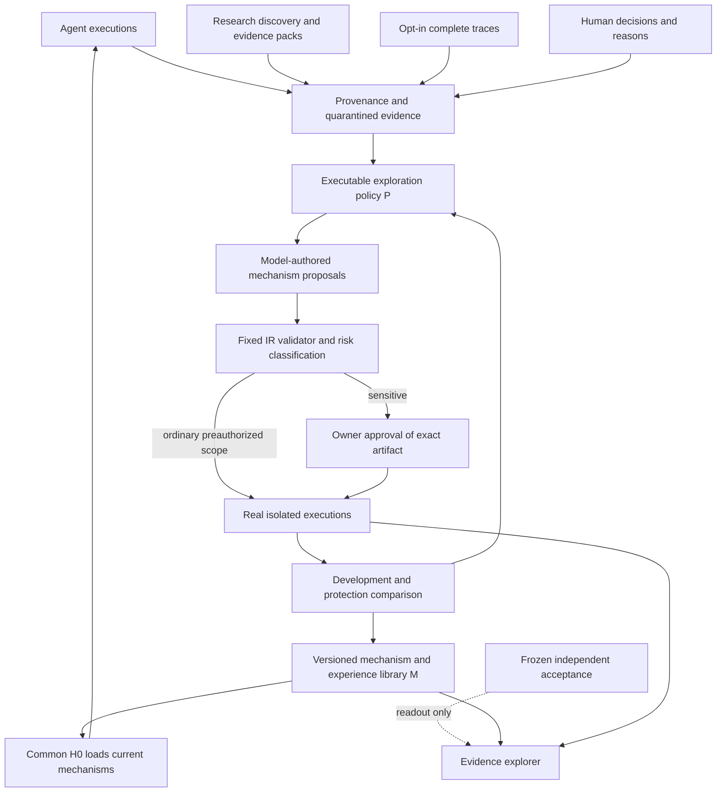

# Architecture

MoltWeave is a continually evolving agent, with three sources of improvement hypotheses: its own executions, external research, and explicitly authorized community traces. A task domain supplies experience; it does not define the product.

## Components and authority

| Component | Inputs → actions → outputs | Authority |
|---|---|---|
| Model client | messages → real compatible API call → output, usage, receipt | No host credentials in model context or receipts |
| H0 task host | current mechanism + authorized evidence → ranking, actual tool-state transitions, model answer → sealed trace | Fixed permissions and grader; resets transient state per case |
| M mechanism library | adopted expressions, prompts and reusable experience → versioned artifacts | No arbitrary Python, file/network access, or changes to outer authority |
| P exploration policy | observed failures and executed search history → ranked next mechanism branches | Changes search decisions; cannot grant approval or alter reward |
| Research | feeds and accessible source text → versioned evidence pack → hypothesis | Source text remains untrusted; observed facts, decisions and measured effects are separate |
| Community | explicit consent + authenticated upload → private raw trace, quarantined analysis and scoped derivatives | No tenant identity from user-supplied trace labels; personal and global permissions differ |
| Governance | exact diff/base/dependencies/scope/action → signed single-use approval → authorized operation | Fixed host; never an evolvable component |
| Acceptance | frozen versions and unseen tasks → actual model executions → denominators and failures | Results do not flow back to optimizer or choose the winning generation |

## Executable representation

The initial implementation uses a bounded expression IR rather than unrestricted generated Python. An expression is a numeric constant, `{ "var": "age" }`, or an operation such as `{ "op": "sub", "args": [10, { "var": "age" }] }`. Arithmetic, conditionals, comparisons and boolean operations can be composed into algorithms. Depth, size, constants, fields and capabilities are constrained by the fixed loader.

M contains memory/RAG/tool scoring programs, a retry predicate, context allocation and a prompt. P is another executable expression over observed failure, prior attempts, gain and stagnation; it chooses the branches that will generate new candidates. Every loaded program has a content hash. This is mechanism-level RSI, with frozen model weights and a finite host interface. It is not unrestricted code self-rewriting or a claim of general intelligence.

The fixed host filters tenant scope before any ranking. Evolving a scoring rule never grants permission to see another user's data. Tools in the authored benchmark are deterministic, stateful local simulators: retries genuinely advance the outcome state, but they do not call production services.

## One generation

1. Load version Vg; record its hash. Start each task from common H0 and fresh tool attempt state.
2. Execute train/development/protection cases with the real model. Seal outputs before grading.
3. Run the loaded P on observed train failures and historical attempts. Record features, numeric branch scores and selected modules.
4. Ask the model to author general mechanism changes for the selected modules. Validate the allowed IR and changed fields.
5. Give an invalid ordinary IR proposal one model-authored repair attempt using the validator's error. Quarantine sensitive proposals pending owner approval. Run ordinary, preauthorized benchmark candidates and compare development/protection outcomes. API/parse measurement failures stop learning; pending or invalid candidates have unknown effect, not measured zero gain.
6. Adopt only a strict development improvement without aggregate protection regression. Preserve rejected candidates and all actual executions.
7. Ask the model to propose a new P using newly accumulated search history. Treat its adoption as a prospective hypothesis, not proof of improved search. Record the old/new branch choices on the same state.
8. Freeze Vg+1 and its complete diff. Vg+1 must actually run and generate new evidence before the next transition counts as recursion.

Independent acceptance reads all frozen generations once. Adoption scores and final effects may differ. A policy diff or changed branch decision proves a behavior change; it does not alone prove P is better. Frozen-P comparisons and new executed searches are needed for attribution.

## Research and community integration

The executable research module supports discovery, evidence packs and contextual human-decision retrieval. The community module supports self-hosted opt-in trace transport, quarantine, scoped use and withdrawal. They provide separate inputs to the same improvement model. The first core experiment uses authored public synthetic tasks and its own executions. Until an experiment actually consumes research/community hypotheses, their impact on RSI must remain unmeasured.

No raw participant trace is committed to the public repository. Synthetic examples are explicitly labeled. A full trace can remain non-replayable; it may support diagnosis without supporting a causal claim about a new mechanism.

## Evidence artifacts

`manifest.json` freezes conditions and partitions. Each generation stores the loaded program, actual traces, policy decisions, candidate proposals and comparisons, transition, and unified diff. `model-calls/` retains requests, model identity, outputs and token usage locally. `independent/` stores held-out execution results. Public exports must be restricted to synthetic/public tasks and pass secret/private-data checks.

## Limits and next interfaces

Memory read/ranking evolves in the current IR; autonomous creation, correction and migration of durable factual memories is a separate integration milestone. Arbitrary-code sandboxing, production write tools, internet browsing, cross-model replication, official third-party benchmark adapters, and a hosted community service require additional implementation and experiments. They are not implied by unit-test coverage.
