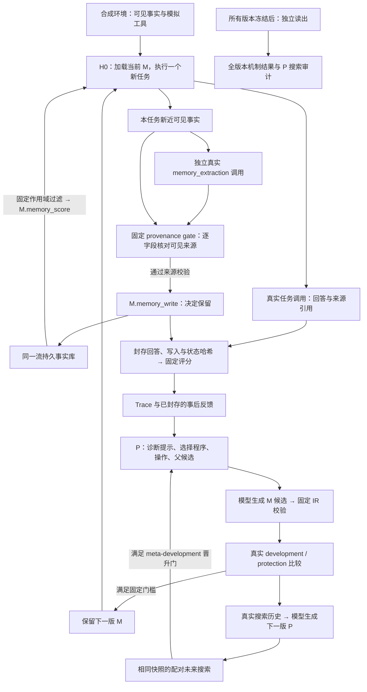
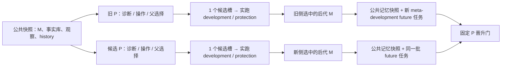

# v0.2 架构：持续积累事实，也改进下一次如何改进

本文按 v0.2 源码说明执行链路与实验边界，配合 [实验协议](v0.2-protocol.md) 阅读。它描述已实现的机制与验证方式；正式执行状态和独立效果以[全量结果报告](../experiments/continual-v02-main/RESULTS.md)为准，不能从机制说明推导提升。工程预检和正式结果分开保存。

MoltWeave 把可改变的部分分成两层：**M 决定怎样读写记忆、检索、选工具和回答；P 决定下一次查哪个失败、采用什么改进操作、从哪个父候选继续。** 固定执行外壳 H0 负责运行它们，来源校验、作用域、评分和晋升规则不交给 M/P 修改。底层模型权重不在本项目中训练。

## 谁拿到什么、做什么、留下什么

| 参与者 | 输入 | 动作 | 输出与边界 |
|---|---|---|---|
| 合成环境 | seed、分区、轮次 | 产生来源事实、修订、治理规则、工具状态和任务 | 可见观察与隐藏评分目标分开；工具是本地模拟，不访问生产服务 |
| 任务执行器 H0 | 当前 M、请求、作用域内记忆、检索结果、工具结果 | 执行排名与有限重试，调用真实任务模型 | 回答、引用、工具事件和 Trace；每个任务是新请求、新工具 attempt 状态 |
| 独立记忆提取模型 | 本任务新近可见、且尚未留存的来源事实 | 单独真实调用，只提出原样复制的事实条目 | `memory_proposals`；看不到隐藏答案、评分反馈或任务模型猜测；提取指令本身固定 |
| 固定记忆校验器与 M | 来源观察、提取条目、当前事实库 | 先校验来源，再用 `M.memory_write` 决定是否保留；读时用 `M.memory_score` 排名 | 带来源的写入、替换、隔离、去重与读取事件；M 不能给虚构事实补一个合法来源 |
| P 与改进模型 | 已封存的执行 Trace、事后可见反馈、真实搜索历史、主流程提供的父程序 | 生成竞争归因，校验引用，用可执行选择程序排序，再生成受限候选 | M/P 候选及预测；模型的原因、信心和成功声明都不是效果证明 |
| 固定比较与验收器 | 实际候选执行、保护集、冻结版本与独立任务 | 判断晋升，或只做独立读出 | 分母、失败、版本链、调用回执；独立结果不回到优化器 |



## 事实库持续存在，单次执行从 H0 重新开始

一条流中的事实库、M、P 和搜索历史跨任务、跨轮保留；一次任务的对话请求和工具重试状态不保留到下一个任务。这里的 H0 reset 指固定外壳重新执行，不是清空事实库，也不是把 M/P 恢复成初始版本。

20 轮协议循环访问四个实体。同一来源家族的修订号随再次访问上升，任务包含观察、立即回忆、修正后回忆、上一轮回忆和三轮延迟回忆。没有新文档或工具结果的回忆任务，需要通过先前实际留下的事实来回答。源头还可能发布“哪个登记处才是当前依据”的规则；某条副本记录经过验证，不代表它天然就是业务认可的答案。

来源校验先于可演化写入决策：提取模型提出的 `source_id/entity/key/value` 必须与本次可见、同 tenant/owner、可信且有效的来源逐项匹配。不存在、篡改、歧义或被撤销的来源不能靠模型自报成功通过。通过这个固定门后，`M.memory_write` 才决定是否保留。

同一 `source_family` 内的新修订可以使旧记录失效；过旧或同版本冲突的条目会被隔离。不同来源的修订号不能互相比大小后覆盖对方。读记忆时先固定过滤 owner/tenant 与有效状态，再由 M 排名；entity/key 是排名特征，不能授予跨用户读取权限。每个事件保留来源、程序哈希和前后关联。

新 M 的保留不会自动重建已经积累的全部事实库。新的读取程序会用于之后的读取，新的写入程序会用于之后的来源提案；实际效果必须从后续执行中观察。

## M 与 P 的可变表面

M 的九个字段是：

```text
memory_score, memory_write, memory_top_k,
rag_score, rag_top_k, tool_score,
retry, max_attempts, prompt
```

这些表达式通过固定解释器执行，具有特征、运算、深度、节点数和数值边界。它们不是可导入任意模块的 Python 程序。M 的任务提示可以改变回答策略；独立记忆提取调用采用固定输出契约，不复用任务回答提示。

P 的四个字段是：

```text
diagnosis_prompt, proposal_prompt, selection_score, operators
```

真实诊断调用读取 Trace，提出模块、原因、证据指针与区分性 probe。主流程不会按任务 family 查表指定模块；诊断输入会去掉原始 family/oracle 等标签，已封存后的可见反馈可供分析。JSON Pointer 必须落到真实 Trace 字段；引用存在只证明来源存在，不证明模型的因果解释正确。

选择器枚举并评分“归因假设 × 改进操作 × 可用父候选”，记录特征、分数、P 哈希和选取结果。操作有三种：

| 操作 | 实际产物 |
|---|---|
| `rewrite` | 改动一个选中模块的合法候选 |
| `contrastive` | 同次生成、校验两个不同程序，模型以 `selected_index` 前瞻选择一个；当前执行器只实跑被选中的程序，两份都生成不等于两份都已测量 |
| `joint` | 实际改动至少两个选中模块；仅声明一个未变字段不算联合修改 |

父候选只能来自主流程绑定的程序与哈希：`current` 或 `best_rejected`。后者是最近一次有已执行但未采用候选的搜索轮中，按保护条件、开发集成功数、保护集成功数排序留下的候选；若本轮没有这类候选，已有的父候选可继续保留。它不是跨不同任务序列求得的全局最优。

改进模型可以真正生成新的 P 提示和选择表达式，但合法改写只得到候选资格。评分规则、来源校验、权限和晋升门仍由外层固定代码掌握。新 P 是否更会搜索，要用下面的真实分叉执行来测量。

## 一轮主搜索与配对 P 检查

每轮先用当前 M/P 执行经验任务并积累事实。两个演化组各有两个主 M 搜索槽：候选从相同事实快照复制出执行状态，实际运行 development/protection；仅严格提高开发集成功数且保护集不退化的候选可以替换当前 M。候选中的临时事实写入不会合并回在线事实库。

之后，真实模型从搜索历史提出 P 候选。旧 P 与候选 P 从相同 M、记忆快照、观察和 history 分叉，每侧只有一个候选搜索槽。两侧共享基线测量，不能读取对方的结果。



future 执行加载各侧选中的 M，但都重新从公共记忆快照出发，不继承候选搜索产生的答案和新记忆。P 晋升要求：两侧都产生有效执行、P 确实不同、选中 M 不同、新侧 future 严格更好、future 保护集不退化。非法候选或无动作仍可保存回退执行的原始结果，但有效搜索差值为未知，不能晋升。

这批 future 是反复用于选 P 的 **meta-development**，不是最终验收。只有通过门槛的 P 进入主轨迹；分叉的后代 M 和记忆都不回流。语法候选最多得到一次模型修复；有界重试后模型、解析或执行测量仍不可用，会保留原始回执并中止，不改写成性能零分。

## 三组连续轨迹

| 组 | 事实持续积累 | M | P |
|---|---|---|---|
| `fixed_mechanism` | 是 | 固定为可工作的权威性、实体、时效、写入与重试基线 | 固定 |
| `fixed_p` | 是 | 每轮两个主搜索槽，可按同一门槛保留 | 固定；P 提案和配对 probe 只作影子记录 |
| `joint` | 是 | 同样的主搜索槽与保留门 | 可经配对未来搜索晋升 |

`fixed_p` 和 `joint` 都运行 P 提案及配对 probe，避免把额外搜索机会直接归因给 P 演化。不同操作、非法提案和修复会产生不同的实际调用数与 token 消耗，因此这里比较的是相同的机会规则，不承诺等 token 或等计算量。版本可以不变；失败、未采用和持平的代都保留。

## 冻结后再测：机制与 P 分开回答

正式协议包含 10 条预定流、每组 20 轮。g0 到 g20 共 21 个状态版本全部冻结后，才做独立读出。开始前复核源码、请求模型与 endpoint、精确任务序列、版本状态哈希及 M/P 父子链。独立结果不会选出“最好的一代”再继续优化，主要终点预先指定为末代。

**机制验收**让每个冻结 M 从空事实库运行同一条新五轮事件序列；任务之间仍持续写入和读取。这样比较的是机制能否建立和使用新事实，而不是某代是否携带更多旧答案。另有新 owner/entity/source 命名空间的 transfer。末代还运行无记忆读写消融，以及读/检索 top-k 均为 6 的固定宽上下文基线。

**P 独立审计**每个 seed 只生成一次公共新观察：以固定 P 组的末态记忆和 history 为基底，用基线 M 执行新 audit-observations，再封存观察、事后记忆与共同输入哈希。P0 与各 checkpoint P 都从这份输入实际进行新候选搜索和 future 执行；正式 20 轮的 checkpoint 包含 g0、g5、g10、g15、g20。末代 P 会真正选择并生成候选，而不是用末代 M 的答题分数替代 P 测试。g0 的 P0 对 P0 是采样波动参照，不是进化收益。

有效搜索配对数、无效配对数、P 哈希是否变化、原始回退结果和有效差值分别保留。统计以预定的流为单位；零温度请求并不能保证模型确定性。

## 四步来源链示意

以下仅说明设计中的数据流，不是已完成实验的结果或成功率：

1. **观察来源。** 实体 A 的 primary 来源第 1 版出现在本任务可见证据里，包含来源 ID、实体、字段与原始值。任务模型回答；独立提取模型只拿这批新事实提出复制条目，看不到评分目标。
2. **校验并写入。** 固定 gate 核对四个字段与作用域；若通过且当前 `memory_write` 为正，事实库留下带来源 ID 的记录与写入事件。没有来源的推断即使写得像事实也不能走这条路径。
3. **稍后读取。** 后续回忆任务没有提供新的来源文档或工具结果。固定作用域过滤后，`memory_score` 决定哪些已有记录进入新模型请求，回答需要引用其来源 ID；是否答对仍待输出封存后的评分。
4. **来源修订。** 同一来源家族第 2 版带来新值。提取、校验和可演化写入决策再次执行；若被合法保留，旧版成为 superseded，并留下前后记录关联。之后的读取是否选到正确新版，必须看实际 Trace，不能由“发生替换”直接推断整题成功。

## 证据与适用范围

本场景的事实、事件序列和工具均为作者构造的公开合成环境；工具状态推进是真实执行的本地模拟，模型调用与记忆事件会留下实际回执。命名空间划分共享同一生成 grammar，因此 transfer 不能写成新业务系统、生产部署或外部原生 benchmark 的收益。来源 verified 表示通过该环境的固定来源条件，不代表真实世界知识已获独立认证。

本文没有给出正式效果数字。研究发现与用户授权 Trace 是另有边界的输入模块；本次核心协议不能自动证明它们已经改善 RSI。若 P 未超过固定 P、宽上下文基线解释了收益，或某些代退化，都应按原样报告。

实现入口：[编排](../src/moltweave/continual.py)、[执行与独立提取](../src/moltweave/continual_runtime.py)、[事实库与来源 gate](../src/moltweave/continual_memory.py)、[M 与表达式边界](../src/moltweave/continual_program.py)、[P 归因与候选生成](../src/moltweave/continual_policy.py)、[合成环境](../src/moltweave/continual_environment.py)。

正式状态、测量完整性、缺失项和效果以 [experiments/continual-v02-main/RESULTS.md](../experiments/continual-v02-main/RESULTS.md) 及其引用的全量报告为准。报告文件存在不等于全部独立读出已完成；执行链、单个成功案例和版本变化也不能替代正式端点。
